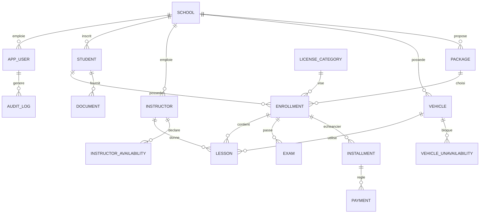

# Projet 1 — Logiciel de gestion d'auto-école

> Objectif : une application web (+ espace élève mobile/PWA) qui remplace le cahier, Excel et WhatsApp pour gérer **planning moniteurs/véhicules, heures de conduite, examens et paiements par tranches**.

---

## 1. Vision et périmètre

### Problème résolu
Une auto-école gère aujourd'hui tout sur papier / Excel : qui conduit avec quel moniteur et quelle voiture, combien d'heures il reste à chaque élève, qui a payé quelle tranche, quand passe qui à l'examen. Résultat : doubles réservations, impayés oubliés, élèves qui appellent pour demander leur planning.

### MVP (à livrer en premier)
1. Gestion des **élèves** (dossier, catégorie de permis, documents)
2. Gestion des **moniteurs** et **véhicules** (disponibilités, indisponibilités)
3. **Planning** des leçons (code + conduite) sans conflit possible
4. **Forfaits** + **paiements par tranches** + reçus PDF
5. **Examens** (code / créneau / conduite) et résultats
6. **Tableau de bord** du gérant (impayés, heures, taux de réussite)
7. **Notifications** (rappel de leçon, rappel de tranche)

### Hors MVP (V2)
- Application mobile native élève / moniteur
- Paiement en ligne
- Quiz de code de la route intégré
- Comptabilité avancée, export vers un logiciel comptable
- Multi-agences (plusieurs sites pour un même propriétaire)
- Suivi GPS des véhicules

---

## 2. Utilisateurs et rôles

| Rôle | Ce qu'il fait |
|---|---|
| **Propriétaire / Gérant** | Tout voir : finances, statistiques, paramètres, utilisateurs |
| **Secrétaire / Accueil** | Inscrire élèves, encaisser, planifier, imprimer reçus |
| **Moniteur** | Voir son planning, valider une leçon effectuée, noter la progression |
| **Élève** | Voir son planning, ses heures restantes, ses paiements, ses documents |
| **Super-admin (toi)** | Gérer les auto-écoles clientes (multi-tenant), support |

---

## 3. Fonctionnalités détaillées

### 3.1 Élèves (candidats)
- Fiche : identité, contact, date de naissance, photo, adresse, contact d'urgence
- Dossier : catégorie de permis (B, A, C, D…), date d'inscription, statut (`ACTIF`, `SUSPENDU`, `TERMINE`, `ABANDON`)
- Documents : pièce d'identité, photos, certificat médical, reçu d'inscription (upload + stockage)
- Historique complet : leçons, examens, paiements
- Compteurs : heures de conduite effectuées / restantes, séances de code suivies

### 3.2 Moniteurs
- Fiche, catégories habilitées, n° d'agrément
- **Disponibilités hebdomadaires** récurrentes (ex. lundi 8h–12h, 14h–18h)
- Congés / absences ponctuelles
- Planning personnel (vue jour / semaine)

### 3.3 Véhicules
- Immatriculation, marque, modèle, catégorie, boîte (manuelle / auto)
- Échéances : assurance, contrôle technique, vidange, vignette → **alertes automatiques**
- Indisponibilités (panne, maintenance)

### 3.4 Planning des leçons
- Vue calendrier (jour / semaine) filtrable par moniteur, véhicule, élève
- Création d'une leçon : élève + moniteur + véhicule + créneau + type (conduite / code / circuit)
- **Détection de conflits** : un moniteur, un véhicule ou un élève ne peut pas être sur deux leçons qui se chevauchent
- Statuts : `PLANIFIEE`, `EFFECTUEE`, `ANNULEE_ELEVE`, `ANNULEE_ECOLE`, `ABSENT`
- Règle d'annulation (ex. moins de 24 h = heure décomptée)
- Drag & drop pour déplacer une leçon
- Récurrence (ex. « tous les mardis 10h pendant 5 semaines »)

### 3.5 Forfaits et paiements par tranches
- Catalogue de **forfaits** (ex. « Permis B : 20 h conduite + code, 60 000 »)
- À l'inscription : choix du forfait → génération d'un **échéancier** (n tranches, dates, montants)
- Encaissement : espèces, chèque, virement, carte (enregistrement manuel au début)
- Paiement partiel d'une tranche géré
- Statut des tranches : `A_VENIR`, `PARTIEL`, `PAYEE`, `EN_RETARD`
- **Reçu PDF** numéroté à chaque encaissement
- **Caisse journalière** : total encaissé par mode de paiement et par utilisateur
- Option : bloquer la planification si impayé au-delà de X jours (configurable)

### 3.6 Examens
- Types : `CODE`, `CRENEAU`, `CONDUITE`
- Convocation : date, heure, lieu, élève, moniteur accompagnateur
- Résultat : `ADMIS`, `AJOURNE`, `ABSENT` + commentaire
- Historique des tentatives (1re, 2e, 3e fois) — important pour facturer les passages supplémentaires
- Statistiques : taux de réussite global, par moniteur, par type

### 3.7 Notifications
- Rappel de leçon (J-1, H-2)
- Rappel de tranche à payer (J-3, J0, J+3)
- Convocation d'examen
- Alertes internes : assurance véhicule qui expire, élève sans leçon depuis 30 jours
- Canaux : email (MVP), SMS / WhatsApp via fournisseur (V1.1)

### 3.8 Tableau de bord gérant
- CA du mois, encaissé vs attendu, total impayés
- Nombre d'élèves actifs, nouvelles inscriptions
- Taux de remplissage des moniteurs / véhicules
- Taux de réussite aux examens
- Liste « élèves à relancer »

---

## 4. Règles métier clés

1. **Zéro chevauchement** : contrainte garantie **en base de données** (pas seulement dans le code) — voir §7.2.
2. Une leçon ne peut être planifiée que si le moniteur est **disponible** et habilité pour la catégorie du véhicule.
3. Une leçon `EFFECTUEE` décompte les heures du forfait ; `ANNULEE_ELEVE` tardive décompte aussi (selon paramètre).
4. Un élève ne peut pas être inscrit à l'examen de conduite tant que le **minimum d'heures** de la catégorie n'est pas atteint (paramétrable).
5. Le montant total des tranches = prix du forfait (contrôle à la création de l'échéancier).
6. Un paiement n'est **jamais supprimé** : on l'annule avec un paiement négatif / un statut `ANNULE` + motif (traçabilité).
7. Toute modification sensible (prix, annulation de paiement, suppression) est écrite dans un **journal d'audit**.

---

## 5. Architecture

### 5.1 Vue d'ensemble

```
┌───────────────────┐     HTTPS      ┌───────────────────────────────────┐
│  React SPA (Vite) │ ─────────────► │  Nginx (reverse proxy + TLS)      │
│  Back-office      │                └──────────────┬────────────────────┘
│  + Espace élève   │                               │
└───────────────────┘                               ▼
                                     ┌───────────────────────────────────┐
                                     │  Spring Boot 3 (API REST)         │
                                     │  Monolithe modulaire              │
                                     │  ├─ auth / tenants                │
                                     │  ├─ students / instructors / cars │
                                     │  ├─ scheduling (planning)         │
                                     │  ├─ billing (forfaits, tranches)  │
                                     │  ├─ exams                         │
                                     │  ├─ notifications (jobs planifiés)│
                                     │  └─ reporting / PDF               │
                                     └──────┬───────────┬────────────────┘
                                            │           │
                                  ┌─────────▼──┐   ┌────▼─────────────┐
                                  │ PostgreSQL │   │ Stockage fichiers │
                                  │     16     │   │ (MinIO / S3)      │
                                  └────────────┘   └──────────────────┘
                                            │
                                  ┌─────────▼─────────┐
                                  │ SMTP / SMS / WA   │
                                  └───────────────────┘
```

### 5.2 Choix d'architecture
- **Monolithe modulaire** (pas de microservices) : un seul déploiement, un seul schéma de base, des packages bien séparés par domaine. C'est le bon choix pour un développeur seul / petite équipe.
- **Multi-tenant par colonne** : chaque table métier a un `school_id`. Un filtre (Hibernate `@Filter` ou Row-Level Security PostgreSQL) l'applique automatiquement à chaque requête → une auto-école ne voit jamais les données d'une autre.
- **API REST** documentée avec OpenAPI/Swagger.
- **Jobs planifiés** (`@Scheduled` + ShedLock) pour relances et alertes.
- **Architecture en couches** par module : `controller → service → repository → entity`, avec des DTO (jamais d'entité JPA exposée).

---

## 6. Stack technique

| Couche | Choix | Pourquoi |
|---|---|---|
| Backend | **Java 21 + Spring Boot 3** (Web, Data JPA, Security, Validation) | Tu le maîtrises déjà |
| Base de données | **PostgreSQL 16** | Contraintes d'exclusion (anti-chevauchement), JSONB, fiabilité |
| Migrations | **Flyway** | Schéma versionné et reproductible |
| Auth | **Spring Security + JWT** (access 15 min + refresh token) | Simple pour SPA + mobile |
| Frontend | **React + TypeScript + Vite** | Rapide, typé |
| UI | **shadcn/ui + Tailwind** (ou MUI) | Composants prêts à l'emploi |
| Calendrier | **FullCalendar** (resource timeline) | Vue par moniteur / véhicule + drag & drop |
| Data fetching | **TanStack Query** + **React Hook Form + Zod** | Cache, formulaires validés |
| PDF | **OpenPDF** ou **JasperReports** | Reçus, convocations |
| Fichiers | **MinIO** (auto-hébergé) ou **S3** | Documents élèves |
| Emails | **Spring Mail** + template **Thymeleaf** | Notifications |
| SMS / WhatsApp | Fournisseur au choix (abstraction `NotificationChannel`) | Remplaçable selon le marché |
| Tests | JUnit 5, **Testcontainers** (PostgreSQL réel), Mockito ; Vitest + Playwright côté front | Tests fiables |
| Conteneurs | **Docker + Docker Compose** | Même environnement partout |
| CI/CD | **GitHub Actions** | Build, tests, déploiement |
| Hébergement | VPS (Hetzner / OVH / équivalent) + Nginx + Let's Encrypt | Coût faible |
| Supervision | Spring Actuator + Prometheus/Grafana (ou simple UptimeRobot au début) | Détecter les pannes |
| Mobile (V2) | **PWA** d'abord, puis **React Native/Expo** si besoin | Réutilise ton code React |

---

## 7. Base de données

### 7.1 Schéma entité-relation



### 7.2 Tables principales (SQL PostgreSQL)

```sql
CREATE EXTENSION IF NOT EXISTS btree_gist;

-- Tenant
CREATE TABLE school (
  id BIGINT GENERATED ALWAYS AS IDENTITY PRIMARY KEY,
  name VARCHAR(150) NOT NULL,
  phone VARCHAR(30), email VARCHAR(150), address TEXT,
  settings JSONB NOT NULL DEFAULT '{}',   -- règles : délai annulation, min. heures examen, etc.
  created_at TIMESTAMPTZ NOT NULL DEFAULT now()
);

-- Utilisateurs applicatifs
CREATE TABLE app_user (
  id BIGINT GENERATED ALWAYS AS IDENTITY PRIMARY KEY,
  school_id BIGINT NOT NULL REFERENCES school(id),
  email VARCHAR(150) NOT NULL,
  password_hash VARCHAR(100) NOT NULL,
  role VARCHAR(20) NOT NULL CHECK (role IN ('OWNER','SECRETARY','INSTRUCTOR','STUDENT','SUPER_ADMIN')),
  active BOOLEAN NOT NULL DEFAULT true,
  UNIQUE (school_id, email)
);

CREATE TABLE license_category (          -- référentiel global
  id SMALLINT PRIMARY KEY,
  code VARCHAR(10) NOT NULL UNIQUE,      -- B, A, C, D...
  label VARCHAR(80) NOT NULL,
  min_driving_hours SMALLINT NOT NULL DEFAULT 0
);

CREATE TABLE student (
  id BIGINT GENERATED ALWAYS AS IDENTITY PRIMARY KEY,
  school_id BIGINT NOT NULL REFERENCES school(id),
  user_id BIGINT REFERENCES app_user(id),
  first_name VARCHAR(80) NOT NULL, last_name VARCHAR(80) NOT NULL,
  birth_date DATE, phone VARCHAR(30), email VARCHAR(150), address TEXT,
  id_number VARCHAR(50), photo_url TEXT,
  emergency_contact VARCHAR(150),
  status VARCHAR(15) NOT NULL DEFAULT 'ACTIVE',
  created_at TIMESTAMPTZ NOT NULL DEFAULT now()
);

CREATE TABLE instructor (
  id BIGINT GENERATED ALWAYS AS IDENTITY PRIMARY KEY,
  school_id BIGINT NOT NULL REFERENCES school(id),
  user_id BIGINT REFERENCES app_user(id),
  first_name VARCHAR(80) NOT NULL, last_name VARCHAR(80) NOT NULL,
  phone VARCHAR(30), license_number VARCHAR(50),
  categories VARCHAR(10)[] NOT NULL DEFAULT '{}',
  active BOOLEAN NOT NULL DEFAULT true
);

CREATE TABLE vehicle (
  id BIGINT GENERATED ALWAYS AS IDENTITY PRIMARY KEY,
  school_id BIGINT NOT NULL REFERENCES school(id),
  plate VARCHAR(20) NOT NULL, brand VARCHAR(50), model VARCHAR(50),
  category_code VARCHAR(10) NOT NULL,
  transmission VARCHAR(10) DEFAULT 'MANUAL',
  insurance_expiry DATE, inspection_expiry DATE,
  active BOOLEAN NOT NULL DEFAULT true,
  UNIQUE (school_id, plate)
);

CREATE TABLE instructor_availability (   -- récurrente
  id BIGINT GENERATED ALWAYS AS IDENTITY PRIMARY KEY,
  instructor_id BIGINT NOT NULL REFERENCES instructor(id),
  day_of_week SMALLINT NOT NULL CHECK (day_of_week BETWEEN 1 AND 7),
  start_time TIME NOT NULL, end_time TIME NOT NULL,
  CHECK (end_time > start_time)
);

CREATE TABLE time_off (                  -- congés moniteur OU indispo véhicule
  id BIGINT GENERATED ALWAYS AS IDENTITY PRIMARY KEY,
  school_id BIGINT NOT NULL REFERENCES school(id),
  instructor_id BIGINT REFERENCES instructor(id),
  vehicle_id BIGINT REFERENCES vehicle(id),
  period TSTZRANGE NOT NULL,
  reason VARCHAR(200),
  CHECK ((instructor_id IS NULL) <> (vehicle_id IS NULL))
);

-- Forfaits
CREATE TABLE package (
  id BIGINT GENERATED ALWAYS AS IDENTITY PRIMARY KEY,
  school_id BIGINT NOT NULL REFERENCES school(id),
  name VARCHAR(120) NOT NULL,
  category_code VARCHAR(10) NOT NULL,
  driving_hours NUMERIC(5,1) NOT NULL,
  code_sessions SMALLINT NOT NULL DEFAULT 0,
  price NUMERIC(12,2) NOT NULL CHECK (price >= 0),
  active BOOLEAN NOT NULL DEFAULT true
);

-- Dossier d'un élève (un élève peut avoir plusieurs dossiers : B puis A)
CREATE TABLE enrollment (
  id BIGINT GENERATED ALWAYS AS IDENTITY PRIMARY KEY,
  school_id BIGINT NOT NULL REFERENCES school(id),
  student_id BIGINT NOT NULL REFERENCES student(id),
  package_id BIGINT NOT NULL REFERENCES package(id),
  category_code VARCHAR(10) NOT NULL,
  price NUMERIC(12,2) NOT NULL,          -- copie figée du prix au moment de l'inscription
  hours_included NUMERIC(5,1) NOT NULL,
  status VARCHAR(15) NOT NULL DEFAULT 'ACTIVE',
  enrolled_on DATE NOT NULL DEFAULT current_date
);

-- Leçons : anti-chevauchement garanti par la base
CREATE TABLE lesson (
  id BIGINT GENERATED ALWAYS AS IDENTITY PRIMARY KEY,
  school_id BIGINT NOT NULL REFERENCES school(id),
  enrollment_id BIGINT NOT NULL REFERENCES enrollment(id),
  student_id BIGINT NOT NULL REFERENCES student(id),
  instructor_id BIGINT NOT NULL REFERENCES instructor(id),
  vehicle_id BIGINT REFERENCES vehicle(id),     -- null pour une séance de code
  lesson_type VARCHAR(15) NOT NULL CHECK (lesson_type IN ('DRIVING','CODE','CIRCUIT')),
  period TSTZRANGE NOT NULL,
  status VARCHAR(20) NOT NULL DEFAULT 'PLANNED',
  notes TEXT,
  created_at TIMESTAMPTZ NOT NULL DEFAULT now(),
  -- un moniteur / un véhicule / un élève ne peut pas avoir 2 leçons actives qui se chevauchent
  EXCLUDE USING gist (instructor_id WITH =, period WITH &&)
    WHERE (status IN ('PLANNED','DONE')),
  EXCLUDE USING gist (vehicle_id WITH =, period WITH &&)
    WHERE (status IN ('PLANNED','DONE') AND vehicle_id IS NOT NULL),
  EXCLUDE USING gist (student_id WITH =, period WITH &&)
    WHERE (status IN ('PLANNED','DONE'))
);
CREATE INDEX idx_lesson_school_period ON lesson USING gist (school_id, period);

-- Examens
CREATE TABLE exam (
  id BIGINT GENERATED ALWAYS AS IDENTITY PRIMARY KEY,
  school_id BIGINT NOT NULL REFERENCES school(id),
  enrollment_id BIGINT NOT NULL REFERENCES enrollment(id),
  exam_type VARCHAR(15) NOT NULL CHECK (exam_type IN ('CODE','CRENEAU','DRIVING')),
  attempt_no SMALLINT NOT NULL DEFAULT 1,
  scheduled_at TIMESTAMPTZ NOT NULL,
  location VARCHAR(200),
  result VARCHAR(10) CHECK (result IN ('PASSED','FAILED','ABSENT')),
  score SMALLINT, comment TEXT
);

-- Échéancier & paiements
CREATE TABLE installment (
  id BIGINT GENERATED ALWAYS AS IDENTITY PRIMARY KEY,
  school_id BIGINT NOT NULL REFERENCES school(id),
  enrollment_id BIGINT NOT NULL REFERENCES enrollment(id),
  seq_no SMALLINT NOT NULL,
  due_date DATE NOT NULL,
  amount NUMERIC(12,2) NOT NULL CHECK (amount > 0),
  status VARCHAR(10) NOT NULL DEFAULT 'UPCOMING',   -- UPCOMING / PARTIAL / PAID / OVERDUE
  UNIQUE (enrollment_id, seq_no)
);

CREATE TABLE payment (
  id BIGINT GENERATED ALWAYS AS IDENTITY PRIMARY KEY,
  school_id BIGINT NOT NULL REFERENCES school(id),
  installment_id BIGINT NOT NULL REFERENCES installment(id),
  receipt_no VARCHAR(30) NOT NULL,
  amount NUMERIC(12,2) NOT NULL,
  method VARCHAR(15) NOT NULL CHECK (method IN ('CASH','CHECK','TRANSFER','CARD','ONLINE')),
  paid_at TIMESTAMPTZ NOT NULL DEFAULT now(),
  received_by BIGINT REFERENCES app_user(id),
  status VARCHAR(10) NOT NULL DEFAULT 'VALID',       -- VALID / CANCELLED
  cancel_reason TEXT,
  UNIQUE (school_id, receipt_no)
);

CREATE TABLE document (
  id BIGINT GENERATED ALWAYS AS IDENTITY PRIMARY KEY,
  school_id BIGINT NOT NULL REFERENCES school(id),
  student_id BIGINT NOT NULL REFERENCES student(id),
  doc_type VARCHAR(30) NOT NULL,
  storage_key TEXT NOT NULL,
  uploaded_at TIMESTAMPTZ NOT NULL DEFAULT now()
);

CREATE TABLE notification (
  id BIGINT GENERATED ALWAYS AS IDENTITY PRIMARY KEY,
  school_id BIGINT NOT NULL REFERENCES school(id),
  recipient_student_id BIGINT REFERENCES student(id),
  channel VARCHAR(10) NOT NULL, template VARCHAR(40) NOT NULL,
  payload JSONB, scheduled_for TIMESTAMPTZ NOT NULL,
  sent_at TIMESTAMPTZ, status VARCHAR(10) NOT NULL DEFAULT 'PENDING'
);

CREATE TABLE audit_log (
  id BIGINT GENERATED ALWAYS AS IDENTITY PRIMARY KEY,
  school_id BIGINT NOT NULL, user_id BIGINT,
  entity VARCHAR(40) NOT NULL, entity_id BIGINT,
  action VARCHAR(20) NOT NULL, details JSONB,
  at TIMESTAMPTZ NOT NULL DEFAULT now()
);
```

> **Pourquoi `EXCLUDE USING gist` ?** Même si deux secrétaires cliquent en même temps, PostgreSQL refusera la deuxième leçon qui chevauche. C'est la garantie la plus solide contre les doubles réservations. Côté Spring, tu attrapes la `DataIntegrityViolationException` et tu renvoies un `409 Conflict` avec un message clair.

### 7.3 Index et performances
- Index GiST sur `lesson(period)` (déjà créé) ; index B-tree sur toutes les FK `school_id`, `student_id`, `enrollment_id`.
- Index partiel sur `installment(due_date) WHERE status IN ('UPCOMING','PARTIAL','OVERDUE')` pour les relances.
- Vues SQL ou requêtes dédiées pour le tableau de bord (heures restantes = `hours_included - SUM(durée des leçons DONE)`).

---

## 8. API REST (aperçu)

```
POST   /api/auth/login | /refresh | /logout

GET    /api/students?query=&status=&page=
POST   /api/students
GET    /api/students/{id}                 PUT /api/students/{id}
POST   /api/students/{id}/documents       (multipart)
GET    /api/students/{id}/balance         → heures restantes + solde dû

GET    /api/instructors                   POST /api/instructors
PUT    /api/instructors/{id}/availability
GET    /api/vehicles                      POST /api/vehicles

GET    /api/lessons?from=&to=&instructorId=&vehicleId=&studentId=
POST   /api/lessons                       → 409 si conflit
PATCH  /api/lessons/{id}/reschedule
PATCH  /api/lessons/{id}/status           (DONE, CANCELLED_*, NO_SHOW)
GET    /api/lessons/availability?date=&instructorId=   → créneaux libres

GET    /api/packages                      POST /api/packages
POST   /api/enrollments                   → crée dossier + échéancier
GET    /api/enrollments/{id}/installments
POST   /api/installments/{id}/payments    → crée paiement + reçu
GET    /api/payments/{id}/receipt.pdf
GET    /api/cash-register?date=

GET    /api/exams?from=&to=               POST /api/exams
PATCH  /api/exams/{id}/result

GET    /api/dashboard/summary
```

Conventions : pagination `?page=&size=`, erreurs au format **RFC 7807 (Problem Details)**, dates en ISO-8601 UTC, montants en `BigDecimal`.

---

## 9. Sécurité et conformité

- Mots de passe hachés **BCrypt/Argon2** ; politique de mot de passe minimale
- JWT court + refresh token révocable ; **rôles** vérifiés avec `@PreAuthorize`
- **Isolation tenant** : `school_id` injecté depuis le token, jamais depuis le client ; tests automatiques qui vérifient qu'une école ne voit pas l'autre
- HTTPS obligatoire, CORS restreint, en-têtes de sécurité, rate-limiting sur `/login`
- Validation des entrées (Bean Validation), requêtes paramétrées (JPA) → pas d'injection SQL
- Fichiers uploadés : vérification du type MIME, taille max, noms aléatoires, accès via URL signées
- Données personnelles (identité, photos, certificats médicaux) : chiffrement au repos du disque, accès limité par rôle, durée de conservation définie, **sauvegardes chiffrées**
- Journal d'audit sur les opérations financières et suppressions
- **Sauvegardes** : `pg_dump` quotidien + copie externe ; **tester la restauration** régulièrement

---

## 10. Structure du projet

### Backend
```
autoecole-api/
├─ src/main/java/com/tonnom/autoecole/
│  ├─ common/          (config, security, exceptions, tenant filter, audit)
│  ├─ auth/
│  ├─ school/
│  ├─ student/         (controller, service, repository, entity, dto, mapper)
│  ├─ instructor/
│  ├─ vehicle/
│  ├─ scheduling/      (lessons, availability, conflict handling)
│  ├─ billing/         (packages, enrollments, installments, payments, receipts)
│  ├─ exam/
│  ├─ notification/    (channels/, templates/, jobs/)
│  └─ reporting/       (dashboard, pdf)
├─ src/main/resources/db/migration/   (V1__init.sql, V2__...)
├─ src/test/...
├─ Dockerfile
└─ pom.xml
```

### Frontend
```
autoecole-web/src/
├─ app/            (routes, providers, layout)
├─ features/
│  ├─ students/ instructors/ vehicles/
│  ├─ planning/    (calendrier FullCalendar, formulaire leçon)
│  ├─ billing/     (forfaits, échéancier, encaissement)
│  ├─ exams/ dashboard/ settings/
├─ shared/         (ui, hooks, api client, utils)
└─ student-portal/ (espace élève : planning, solde, documents)
```

---

## 11. Roadmap (développeur seul, ordre de grandeur)

| Phase | Durée | Contenu |
|---|---|---|
| 0. Cadrage | 1 sem. | Interviews 2–3 gérants d'auto-école, maquettes Figma, validation du périmètre |
| 1. Fondations | 1–2 sem. | Repo, Docker, CI, Flyway, auth, multi-tenant, rôles |
| 2. Référentiels | 1–2 sem. | Élèves, moniteurs, véhicules, documents |
| 3. Planning | 2–3 sem. | Calendrier, conflits, disponibilités, statuts |
| 4. Facturation | 2 sem. | Forfaits, échéancier, paiements, reçus PDF, caisse |
| 5. Examens + dashboard | 1–2 sem. | Examens, tentatives, KPIs |
| 6. Notifications | 1 sem. | Emails, jobs de relance, alertes |
| 7. Pilote | 2–4 sem. | Déploiement chez **1 auto-école test**, corrections, formation |
| **Total MVP** | **≈ 11–16 sem.** | |

---

## 12. Qualité, tests, déploiement

- **Tests** : unitaires sur les règles métier (échéancier, décompte d'heures) ; **tests d'intégration avec Testcontainers** pour les contraintes anti-chevauchement ; e2e Playwright sur le parcours « inscrire un élève → planifier → encaisser »
- **CI** : à chaque push → build, tests, analyse (SonarQube/Checkstyle), image Docker
- **CD** : déploiement automatique sur staging, manuel sur production
- **Environnements** : `dev` (local Docker Compose), `staging`, `prod`
- **Observabilité** : logs JSON, endpoint `/actuator/health`, alertes en cas d'erreur 5xx
- **Données de démo** : script de seed pour présenter l'application à des prospects

---

## 13. Modèle économique (pistes)

- Abonnement mensuel par auto-école (ex. palier selon nombre d'élèves actifs ou de moniteurs)
- Frais d'installation + formation + import de l'existant (Excel)
- Options payantes : SMS/WhatsApp, application mobile, multi-agences

---

## 14. Risques et points d'attention

| Risque | Parade |
|---|---|
| Règles propres à chaque pays/école (examens, heures minimales) | Tout rendre **paramétrable** (`school.settings`), ne pas coder en dur |
| Adoption : le gérant garde son cahier | Import Excel, interface très simple, formation sur place |
| Planning trop complexe → bugs | Contraintes en base + tests d'intégration dès le début |
| Perte de données | Sauvegardes quotidiennes + restauration testée |
| Données personnelles sensibles | Chiffrement, accès par rôle, audit, politique de conservation |
| Dépendance à un fournisseur SMS | Interface `NotificationChannel` pour pouvoir en changer |

---

## 15. Checklist de démarrage

- [ ] Rencontrer 2–3 auto-écoles et lister leurs vrais documents (cahier, fiches, reçus)
- [ ] Faire valider le schéma de données avec un gérant
- [ ] Créer le repo, Docker Compose (Postgres + API + web), CI
- [ ] Écrire `V1__init.sql` à partir de la section 7
- [ ] Implémenter auth + tenant + un premier CRUD (élèves) de bout en bout
- [ ] Trouver l'auto-école pilote **avant** de terminer le MVP
